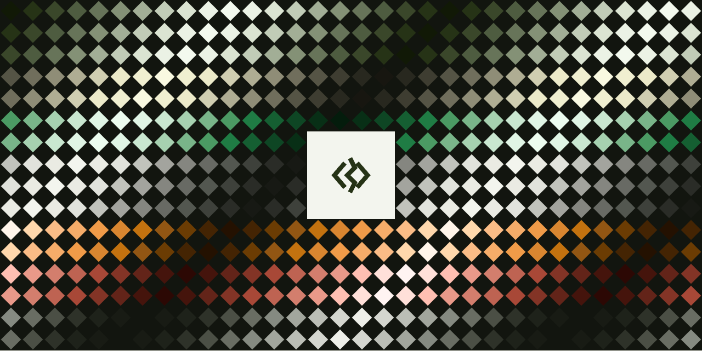
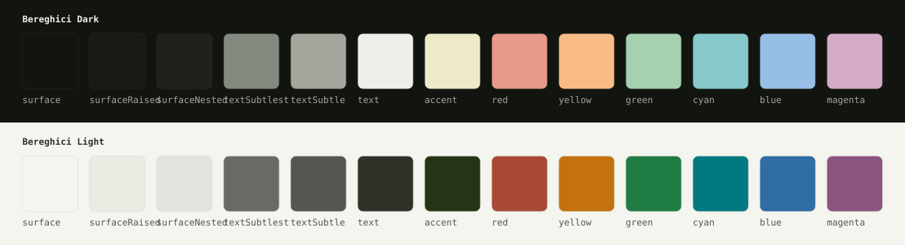

<p align="center">
  
</p>

<h1 align="center">Bereghici Themes</h1>

<p align="center">
  Bereghici Dark and Light for terminals, editors, command-line tools and apps, generated from the
  <a href="https://github.com/abereghici/design-system">Bereghici Design System</a> tokens.
</p>

<p align="center">
  <a href="https://github.com/abereghici/themes/actions/workflows/ci.yml"></a>
  <a href="LICENSE"></a>
</p>

## Install

```sh
git clone https://github.com/abereghici/themes ~/.local/share/bereghici
~/.local/share/bereghici/install.sh
```

[`install.sh`](install.sh) is for macOS: it reads the appearance with `defaults` and puts the font in `~/Library/Fonts`. The theme files themselves work on any system, from each port's `themes/`.

`install.sh` links each theme where its tool reads it, so a `git pull` updates those tools without installing again; VS Code and the font keep a copy, so run `install.sh` again after pulling. It replaces only links of its own or broken ones, never a file or link of yours, and copies the font only over an older copy of itself. A step that fails is reported without stopping the others, and the script then exits non-zero. `pnpm test` runs it against a scratch home to check each of these. A clone elsewhere is linked at `~/.local/share/bereghici`, the one path every port's usage names. Each port's README says what to add to the tool's config.

Claude Code and Codex take one theme rather than one per appearance: run `install.sh sync dark` or `install.sh sync light` from whatever switches the appearance.

## Flavors

Each port ships the flavors its tool can use, as `themes/bereghici-<flavor>.<ext>`:

- **dark** and **light**: Bereghici Dark and Light in their own colors.
- **terminal**: each role as the ANSI color a Bereghici terminal theme gives it. A tool in this flavor switches with the terminal, live, even when it has no light/dark setting of its own (fzf, Starship, eza, zsh). Its `surface` and `surfaceRaised` are the terminal's own background.

## Transparency

The terminal ports leave the background to the terminal, so a translucent one (Ghostty's `background-opacity`) shows through. They color only selections, badges, code blocks and diff lines. `pnpm test` checks the ones that would otherwise cover the screen:

- tmux draws its status bar, popups and menus with `bg=default`.
- herdr's sidebar uses `sidebar_bg = "reset"`.
- fzf's terminal flavor sets `bg:-1` and `gutter:-1`; its dark and light flavors paint Bereghici's background, for a terminal in other colors.
- Neovim clears its backgrounds with `setup({ transparent = true })`, except the completion menu's, which stays solid to read over code, and nvim-notify's, which its fade needs.

Desktop apps (VS Code, Chrome, Obsidian, Raycast) draw their own windows.

## Palette



Every value comes from [`@abereghici/tokens`](https://www.npmjs.com/package/@abereghici/tokens): the design system's primitives and semantic colors, mapped to these roles in [`terminal.tokens.json`](packages/palette/src/tokens/terminal.tokens.json). The roles take the design system's names: surfaces, text, the line highlight, selection and border, `accent`, and the six ANSI hues with their bright pairs. Generated by `pnpm build`:

<!-- generated:palette -->

| Role            | Dark      | Light     | Terminal   |
| --------------- | --------- | --------- | ---------- |
| `surface`       | `#12150f` | `#f3f5ee` | background |
| `surfaceRaised` | `#181b14` | `#eaebe3` | background |
| `surfaceNested` | `#1e221a` | `#e1e3dc` | ANSI 0     |
| `textSubtlest`  | `#858a81` | `#686a64` | ANSI 8     |
| `textSubtle`    | `#a2a69d` | `#535750` | ANSI 7     |
| `text`          | `#eeefe9` | `#2e3229` | ANSI 15    |
| `lineHighlight` | `#1e221a` | `#eaebe3` | ANSI 0     |
| `selection`     | `#4b4f45` | `#c1c3bc` | ANSI 0     |
| `border`        | `#696d63` | `#a3a49e` | ANSI 8     |
| `accent`        | `#eceac9` | `#263316` | ANSI 2     |
| `red`           | `#e99989` | `#a84837` | ANSI 1     |
| `yellow`        | `#fabc86` | `#c3720f` | ANSI 3     |
| `green`         | `#a6d1b0` | `#1f7c44` | ANSI 2     |
| `cyan`          | `#87c8cb` | `#007a80` | ANSI 6     |
| `blue`          | `#97bfe6` | `#2f6da4` | ANSI 4     |
| `magenta`       | `#d4acca` | `#8b537f` | ANSI 5     |
| `redBright`     | `#ffbfb2` | `#833426` | ANSI 9     |
| `yellowBright`  | `#ffd8ac` | `#925613` | ANSI 11    |
| `greenBright`   | `#c9e7d0` | `#155f32` | ANSI 10    |
| `cyanBright`    | `#b3e2e4` | `#005e63` | ANSI 14    |
| `blueBright`    | `#bedbf8` | `#20537f` | ANSI 12    |
| `magentaBright` | `#ebcde3` | `#6b3e62` | ANSI 13    |

<!-- /generated:palette -->

## Contrast

`pnpm test` holds every pair below to its minimum, in both variants, with the WCAG 2.2 contrast ratio ([Color.js](https://colorjs.io/docs/contrast) `WCAG21`, the formula 2.2 keeps). 4.5 is AA for text ([SC 1.4.3](https://www.w3.org/TR/WCAG22/#contrast-minimum)) and 3 is AA for large text and interface marks ([SC 1.4.11](https://www.w3.org/TR/WCAG22/#non-text-contrast)).

Yellow, and the hues on panels and the selection, sit below AA by design, as in Catppuccin Latte: a yellow dark enough for 4.5 on a light background reads as brown, and six hues can't stay apart at 4.5 on every background. Those minimums are lower in the tables, not hidden. WCAG 3 doesn't settle a successor yet: its [working draft](https://www.w3.org/TR/wcag-3.0/) says its contrast algorithm "is yet to be determined", so these are WCAG 2 ratios. Generated by `pnpm build` from the same pairs the tests check:

<!-- generated:contrast -->

**Text on the background and panels**

| Foreground     | Background      | Minimum | Dark  | Light |
| -------------- | --------------- | ------- | ----- | ----- |
| `text`         | `surface`       | 4.50    | 15.93 | 11.91 |
| `text`         | `surfaceRaised` | 4.50    | 15.06 | 10.90 |
| `textSubtle`   | `surface`       | 4.50    | 7.44  | 6.71  |
| `textSubtle`   | `surfaceRaised` | 4.50    | 7.03  | 6.14  |
| `textSubtlest` | `surface`       | 4.50    | 5.22  | 4.98  |
| `textSubtlest` | `surfaceRaised` | 4.50    | 4.93  | 4.56  |
| `accent`       | `surface`       | 4.50    | 15.07 | 12.19 |
| `accent`       | `surfaceRaised` | 4.50    | 14.25 | 11.16 |
| `text`         | `surfaceNested` | 4.50    | 13.98 | 10.11 |
| `accent`       | `surfaceNested` | 4.50    | 13.23 | 10.35 |

**Syntax and ANSI colors on the background**

| Foreground      | Background | Minimum | Dark  | Light |
| --------------- | ---------- | ------- | ----- | ----- |
| `red`           | `surface`  | 4.50    | 8.23  | 5.24  |
| `yellow`        | `surface`  | 3.00    | 11.06 | 3.33  |
| `green`         | `surface`  | 4.50    | 10.85 | 4.75  |
| `cyan`          | `surface`  | 4.50    | 9.79  | 4.67  |
| `blue`          | `surface`  | 4.50    | 9.57  | 4.97  |
| `magenta`       | `surface`  | 4.50    | 9.26  | 5.25  |
| `redBright`     | `surface`  | 4.50    | 11.71 | 7.69  |
| `yellowBright`  | `surface`  | 4.50    | 13.75 | 5.36  |
| `greenBright`   | `surface`  | 4.50    | 13.88 | 7.04  |
| `cyanBright`    | `surface`  | 4.50    | 13.08 | 6.87  |
| `blueBright`    | `surface`  | 4.50    | 12.88 | 7.33  |
| `magentaBright` | `surface`  | 4.50    | 12.61 | 7.67  |

**Syntax and ANSI colors on panels**

| Foreground      | Background      | Minimum | Dark  | Light |
| --------------- | --------------- | ------- | ----- | ----- |
| `red`           | `surfaceRaised` | 3.00    | 7.78  | 4.80  |
| `red`           | `surfaceNested` | 3.00    | 7.22  | 4.45  |
| `yellow`        | `surfaceRaised` | 2.50    | 10.45 | 3.05  |
| `yellow`        | `surfaceNested` | 2.50    | 9.70  | 2.83  |
| `green`         | `surfaceRaised` | 3.00    | 10.26 | 4.35  |
| `green`         | `surfaceNested` | 3.00    | 9.52  | 4.03  |
| `cyan`          | `surfaceRaised` | 3.00    | 9.25  | 4.27  |
| `cyan`          | `surfaceNested` | 3.00    | 8.59  | 3.96  |
| `blue`          | `surfaceRaised` | 3.00    | 9.05  | 4.55  |
| `blue`          | `surfaceNested` | 3.00    | 8.40  | 4.22  |
| `magenta`       | `surfaceRaised` | 3.00    | 8.75  | 4.80  |
| `magenta`       | `surfaceNested` | 3.00    | 8.12  | 4.45  |
| `redBright`     | `surfaceRaised` | 3.00    | 11.07 | 7.04  |
| `redBright`     | `surfaceNested` | 3.00    | 10.28 | 6.53  |
| `yellowBright`  | `surfaceRaised` | 3.00    | 13.00 | 4.91  |
| `yellowBright`  | `surfaceNested` | 3.00    | 12.06 | 4.55  |
| `greenBright`   | `surfaceRaised` | 3.00    | 13.12 | 6.44  |
| `greenBright`   | `surfaceNested` | 3.00    | 12.18 | 5.98  |
| `cyanBright`    | `surfaceRaised` | 3.00    | 12.37 | 6.29  |
| `cyanBright`    | `surfaceNested` | 3.00    | 11.48 | 5.83  |
| `blueBright`    | `surfaceRaised` | 3.00    | 12.17 | 6.71  |
| `blueBright`    | `surfaceNested` | 3.00    | 11.30 | 6.23  |
| `magentaBright` | `surfaceRaised` | 3.00    | 11.92 | 7.02  |
| `magentaBright` | `surfaceNested` | 3.00    | 11.07 | 6.51  |

**Text and syntax colors on the selection**

| Foreground | Background  | Minimum | Dark | Light |
| ---------- | ----------- | ------- | ---- | ----- |
| `text`     | `selection` | 4.50    | 7.25 | 7.35  |
| `red`      | `selection` | 2.00    | 3.75 | 3.24  |
| `yellow`   | `selection` | 2.00    | 5.03 | 2.06  |
| `green`    | `selection` | 2.00    | 4.94 | 2.93  |
| `cyan`     | `selection` | 2.00    | 4.46 | 2.88  |
| `blue`     | `selection` | 2.00    | 4.36 | 3.07  |
| `magenta`  | `selection` | 2.00    | 4.22 | 3.24  |

**Text on diff and search backgrounds**

| Foreground | Background        | Minimum | Dark  | Light |
| ---------- | ----------------- | ------- | ----- | ----- |
| `text`     | `added`           | 4.50    | 12.11 | 9.64  |
| `text`     | `addedEmphasis`   | 4.50    | 8.12  | 7.74  |
| `text`     | `removed`         | 4.50    | 12.56 | 9.55  |
| `text`     | `removedEmphasis` | 4.50    | 9.06  | 7.51  |
| `text`     | `addedStrong`     | 4.50    | 5.28  | 6.06  |
| `text`     | `removedStrong`   | 4.50    | 6.21  | 5.86  |
| `text`     | `changed`         | 4.50    | 12.34 | 9.62  |
| `text`     | `changedEmphasis` | 4.50    | 8.56  | 7.66  |
| `text`     | `search`          | 4.50    | 9.93  | 9.27  |

<!-- /generated:contrast -->

## Ports

<!-- generated:ports -->

| Port                                                      | For          | Switches                  |
| --------------------------------------------------------- | ------------ | ------------------------- |
| [Ghostty](ports/ghostty)                                  | Terminal     | live                      |
| [herdr](ports/herdr)                                      | Terminal     | live                      |
| [tmux](ports/tmux)                                        | Terminal     | live                      |
| [Neovim](ports/nvim)                                      | Editors      | live                      |
| [VS Code](ports/vscode)                                   | Editors      | live                      |
| [bat](ports/bat)                                          | Command line | on start                  |
| [Claude Code](ports/claude-code)                          | Command line | through `install.sh sync` |
| [Codex](ports/codex)                                      | Command line | through `install.sh sync` |
| [delta](ports/delta)                                      | Command line | on start                  |
| [eza](ports/eza)                                          | Command line | live                      |
| [fzf](ports/fzf)                                          | Command line | live                      |
| [glamour (gh, glab, glow)](ports/glamour)                 | Command line | live                      |
| [jq](ports/jq)                                            | Command line | live                      |
| [lazydocker](ports/lazydocker)                            | Command line | live                      |
| [lazygit](ports/lazygit)                                  | Command line | on start                  |
| [ripgrep](ports/ripgrep)                                  | Command line | live                      |
| [Yazi](ports/yazi)                                        | Command line | on start                  |
| [LS_COLORS (fd, ls, zsh completion)](ports/ls-colors)     | Shell        | live                      |
| [Starship](ports/starship)                                | Shell        | live                      |
| [zsh-syntax-highlighting, zsh-autosuggestions](ports/zsh) | Shell        | live                      |
| [Obsidian](ports/obsidian)                                | Apps         | live                      |
| [Raycast](ports/raycast)                                  | Apps         | live                      |
| [Chrome](ports/chrome)                                    | Browser      | by hand                   |
| [Bereghici Symbols](ports/font)                           | Font         | live                      |

<!-- /generated:ports -->

htop and the GitHub and GitLab CLIs' own output use the 16 ANSI colors, so the terminal theme covers them.

## Wallpapers

[`wallpapers/`](wallpapers) has seven dynamic macOS wallpapers in the palette, each switching between a light and a dark image with the appearance.

## How it works

- [`packages/palette`](packages/palette) resolves the design system's DTCG source (`@abereghici/tokens/source/*.tokens.json`) and the terminal roles with Style Dictionary, into the three flavors every template reads.
- [`packages/build`](packages/build) renders each port's `templates/*.mustache`, as Catppuccin's Whiskers does. A template's frontmatter names its output and the flavors it renders in. A tag the view doesn't have fails the build, so a typo can't ship an empty color.
- [`ports.yml`](ports.yml) registers every port: its tool, how it switches and where it installs. The tables in this README, each port's README and `install.sh` are generated from it.
- `pnpm check` renders everything without writing and fails when a committed file differs, so what's in the repository is what the tokens produce. CI runs it on every push.
- `pnpm test` also parses every generated JSON, YAML, TOML and XML file, and runs `bash -n` on the bash files, `zsh -n` on the zsh ones and `git config --list` on the git one.
- It loads the Neovim port in both appearances, with and without `transparent`, and checks that every link has a target. It then compares a sample of each syntax role across Neovim, VS Code and the TextMate theme, against [CONTRIBUTING](CONTRIBUTING.md#syntax)'s table.
- [`packages/font`](packages/font) draws the Bereghici logo into a font, for prompts.

## Contributing

See [CONTRIBUTING.md](CONTRIBUTING.md) for the repository layout, the development commands and how to add a port. Report vulnerabilities as described in [SECURITY.md](SECURITY.md).

## License

[MIT](LICENSE) © abereghici.
