# Bereghici Wallpapers

Dynamic macOS wallpapers in the Bereghici palette. Each `.heic` holds a light and a dark image, and macOS shows the one that matches the appearance, the way it does with its own dynamic wallpapers.

| Wallpaper                                                    | Light                                                | Dark                                               |
| ------------------------------------------------------------ | ---------------------------------------------------- | -------------------------------------------------- |
| [Strata](bereghici-strata.heic)                              | 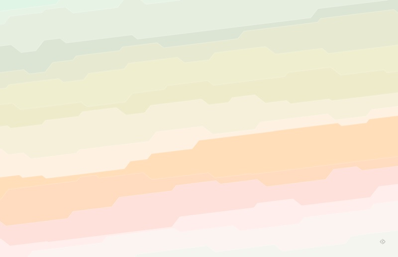          | 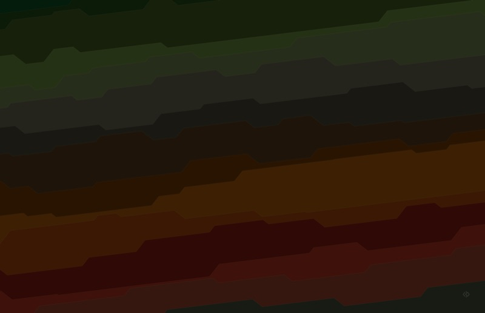          |
| [Stâlpul cerului (Pillar of the Sky)](bereghici-pillar.heic) | 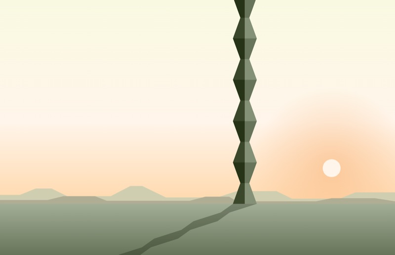 | 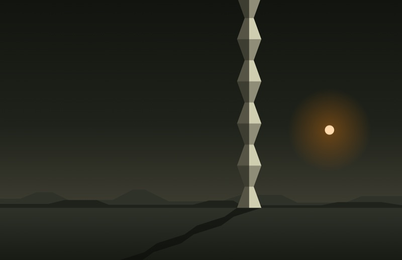 |
| [Ridges](bereghici-ridges.heic)                              | 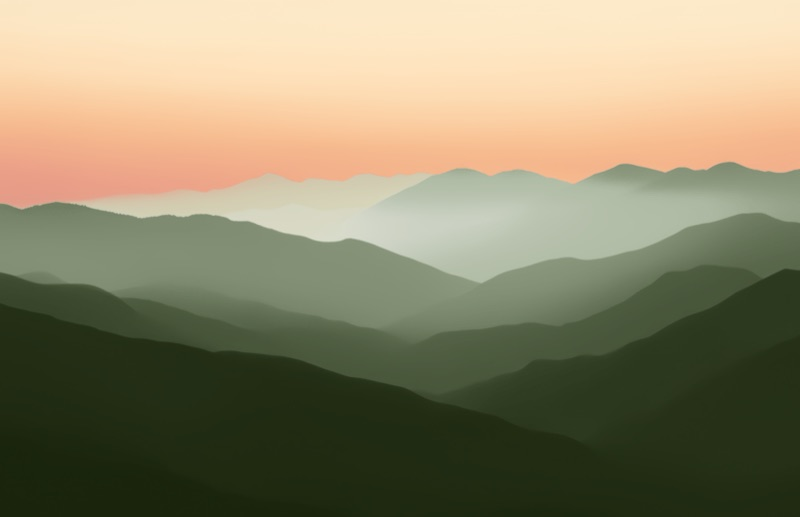          | 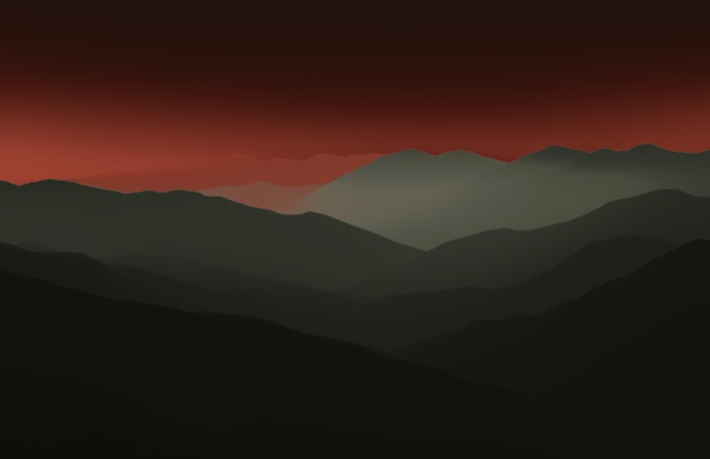          |
| [Overcast](bereghici-overcast.heic)                          | 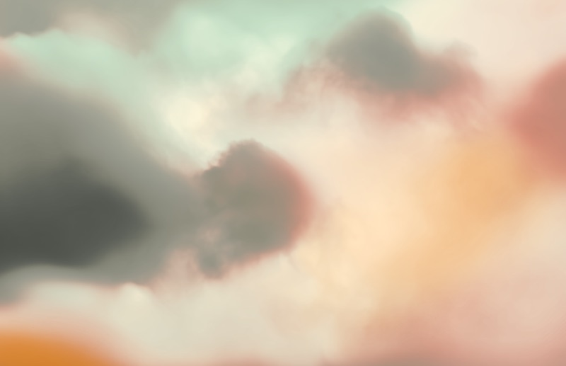      | 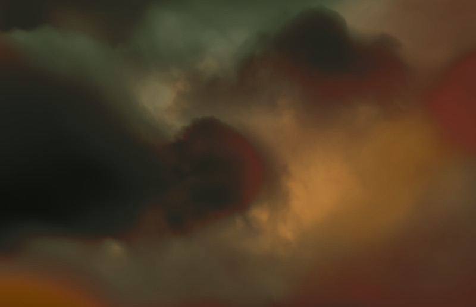      |
| [Honeycomb](bereghici-honeycomb.heic)                        | 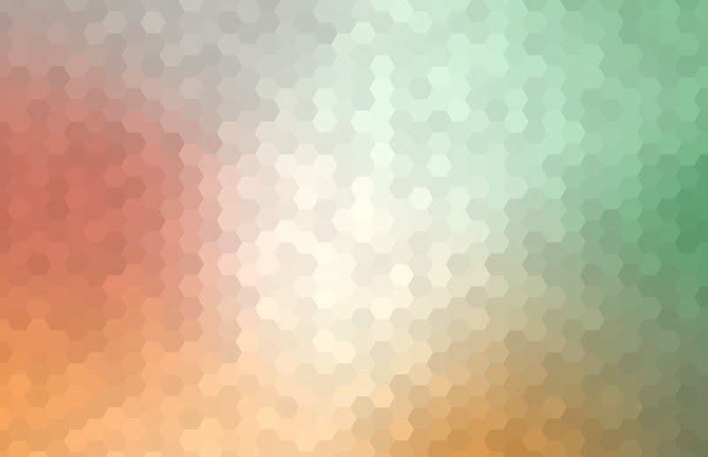    | 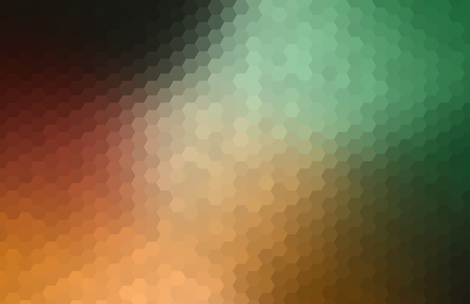    |
| [Contours](bereghici-contours.heic)                          | 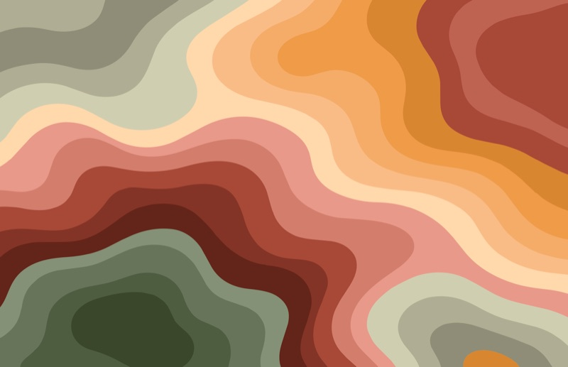      | 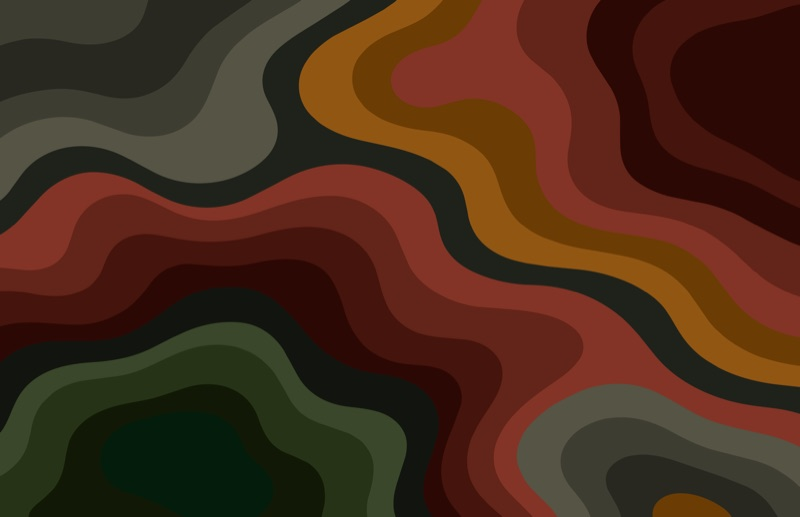      |
| [Lake](bereghici-lake.heic)                                  | 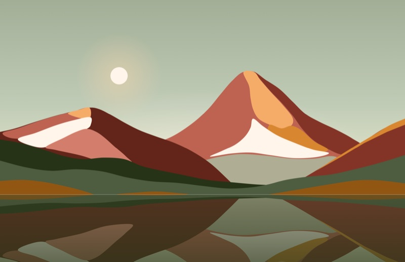              | 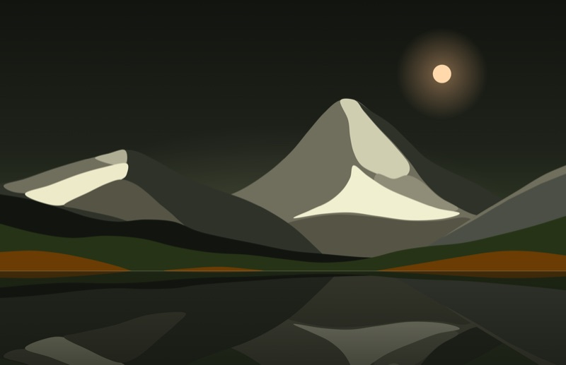              |

Strata keeps every band close to one lightness, so text stays readable over it in a translucent terminal.

## Usage

Open **System Settings → Wallpaper → Add Folder or Album → Choose Folder…**, pick this folder, choose a wallpaper and set it to **Automatic**. Or from a terminal, in this folder:

```sh
osascript -e 'tell application "System Events" to tell every desktop to set picture to POSIX file "'"$PWD"'/bereghici-strata.heic"'
```

## How they're made

The wallpapers are designed in Claude Design and exported as PNGs at 6016 × 3888 (about 1.55:1, a 6K width), so macOS only scales them down. [`dynamic.swift`](dynamic.swift) packs each pair into one HEIC with ImageIO, and marks it with the `apple_desktop:apr` XMP property macOS reads: a binary property list `{l: 0, d: 1}`, the index of the light and the dark image.

```sh
swift wallpapers/dynamic.swift strata-light.png strata-dark.png wallpapers/bereghici-strata.heic
```

The previews are the same PNGs at 800 pixels wide:

```sh
sips -s format jpeg -s formatOptions 82 --resampleWidth 800 strata-light.png --out wallpapers/previews/strata-light.jpg
```
